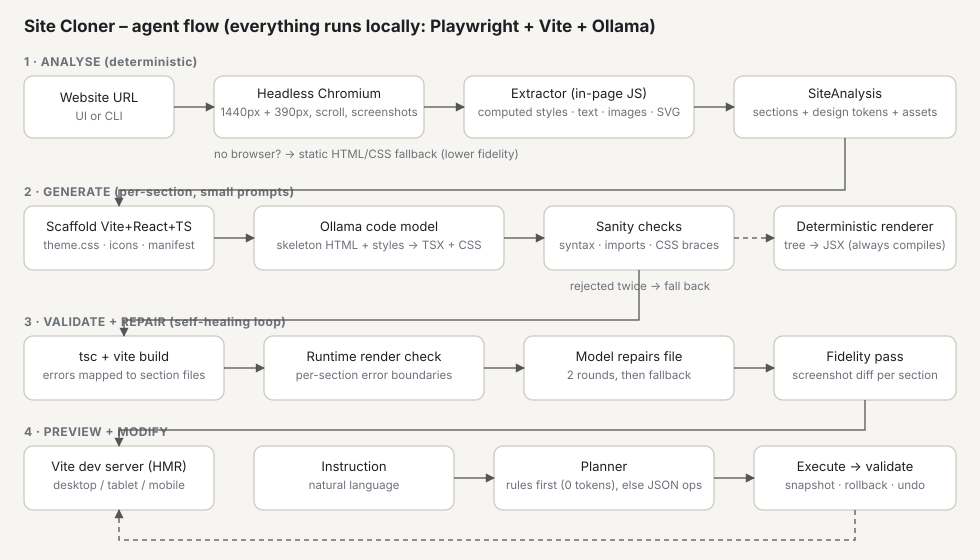

# Site Cloner — AI frontend website cloning agent

Give it a public URL. It analyses the page in a real browser, writes a **React + TypeScript (Vite)** project, validates and self-repairs it, serves a live preview, and lets you edit the result in plain English. **Everything runs locally on Ollama. No API keys, no cloud calls.**



## Setup

Requirements: Node ≥ 18.18, [Ollama](https://ollama.com) running, and any chat model pulled (a code model works best).

```bash
ollama pull qwen2.5-coder:7b        # recommended; any installed chat model is auto-detected
ollama pull llama3.2:3b             # optional: faster planner for edits
npm run setup                        # npm install + Playwright Chromium
npm run doctor                       # checks Node, Ollama, models, browser
npm start                            # UI at http://localhost:3000
```

Or from the terminal: `npm run clone -- https://example.com` (then an interactive `modify>` prompt), or `npm run modify -- <slug> "make the navbar sticky"`.

Optional env vars: `CODE_MODEL`, `FAST_MODEL`, `OLLAMA_HOST`, `NUM_CTX` (default 8192), `FIDELITY_MIN` (default 0.85), `SITES_DIR`, `PORT`, `CHROMIUM_PATH`.
Generated sites are written to `sites/<hostname>/` and are standalone Vite projects (`npm install && npm run dev` inside them also works).

## How it works

1. **Analyse (deterministic, no LLM).** Playwright loads the page at 1440px, scrolls to trigger lazy content, and an in-page script walks the DOM. It records computed styles (only what differs from the parent), text, links, images, inline SVGs, background images, and per-element **style differences at 390px** (this is how responsive behaviour such as a hamburger menu is learned). It segments the page into sections, classifies them (navbar, hero, features, pricing, testimonials, footer…), extracts design tokens (primary colour from CTA usage, fonts, radius, container width), downloads images locally, and screenshots every section.
2. **Generate (per section).** One small prompt per section: an annotated skeleton (`s="…"` desktop styles, `m="…"` mobile deltas) goes to the Ollama code model, which returns a TSX component + CSS. Output is sanity-checked (syntax, allowed imports, CSS braces), literal colours are rewritten to theme variables, and the section is written to `src/sections/`. If the model fails twice, a **deterministic tree→JSX renderer** produces the section instead, so the pipeline always yields a working site.
3. **Validate and repair.** `tsc` and a `vite build` run in-process; errors are mapped to the owning section file and sent back to the model with the exact messages (2 rounds), then replaced by the deterministic renderer if still broken. In the browser, every section sits in an error boundary, so a runtime crash is attributed to one component instead of blanking the page.
4. **Visual fidelity pass.** Each model-written section is screenshotted and compared with the original (block colour, edge map, height). Sections below `FIDELITY_MIN` are compared against the deterministic rebuild and the closer one is kept.
5. **Preview and modify.** A Vite dev server (HMR) is shown in the UI with desktop/tablet/mobile widths and an Original/Clone toggle. Edits go through a planner → op executor → validator, with a snapshot taken first so any failure rolls back automatically; **Undo** restores the previous version.

### Natural-language edits
Common requests are handled by rules at **zero token cost** ("change the primary color to blue", "make the navbar sticky", "remove the pricing section", "move X above Y", "add a testimonials section", "replace the hero section with a bakery hero"). Anything else goes to the fast model, which emits a small JSON plan of typed operations (`set_theme`, `add_section`, `remove_section`, `replace_section`, `move_section`, `edit_section`, `global_css`); only `edit_section`/`add_section`/`replace_section` need the code model. Section order lives in `.cloner/manifest.json`, and `src/sections/index.ts` is regenerated from it, so adding, removing and reordering never depend on the model producing correct glue code.

## Key decisions
- **Facts from the browser, code from the model.** Small local models are poor at inferring layout from raw HTML, so the model gets measured values and only has to write clean component code.
- **Always-compiles fallback.** Reliability comes from validation plus a deterministic path, not from trusting the model.
- **Theme variables everywhere.** Generated CSS is rewritten to `var(--color-primary)` etc., which makes recolouring a one-line change.
- **Small prompts, explicit context.** One section per call (≤ 7k chars of skeleton, degraded gracefully by shortening text, collapsing repeats, flattening depth); `num_ctx` is set explicitly because Ollama otherwise truncates silently.
- **Cost awareness.** Local inference costs no money, so the budget is time and tokens: per-section calls, rule-based edits, a response cache (identical prompts are free on re-run), a small planner model, and token/call/cache-hit stats printed after each run.
- **Not an embed.** Output is new React code with local assets; nothing iframes or proxies the source site.

## Limitations
- Static snapshot: no JS interactivity beyond what the model writes (menus, tabs, carousels, animations, video backgrounds are not reproduced). Logged-in or bot-protected pages cannot be analysed.
- Very long pages are capped at 14 sections (adjacent small ones are merged) and 450 nodes per section.
- Without a browser, analysis degrades to static HTML/CSS and fidelity drops; use `npm run doctor`.
- Visual score is a cheap perceptual metric (used to compare two candidates), not a pixel-perfect measure.
- Model quality matters: 7B-class models need the repair/fallback path more often than larger ones.
- Web fonts load from the original font CDN if the site used one; image assets over 3 MB are skipped.

## Tests
`npm test` runs unit tests plus an offline integration test against a fake Ollama (generation, self-repair, planning, editing, rollback, undo). `npm run typecheck` checks the agent itself.

## Layout
```
src/analyze/   browser capture, DOM extractor, tokens, section classifier, assets, static fallback
src/generate/  prompts, skeleton serialiser, LLM section writer, deterministic renderer, scaffold
src/validate/  tsc + vite checks, runtime render check, repair loop, screenshot fidelity
src/modify/    rule-based intents, LLM planner ops, executor, rollback / undo
src/ollama.ts  streaming client, model auto-selection, response cache
ui/            single-file control panel      template/  generated-site skeleton
```
